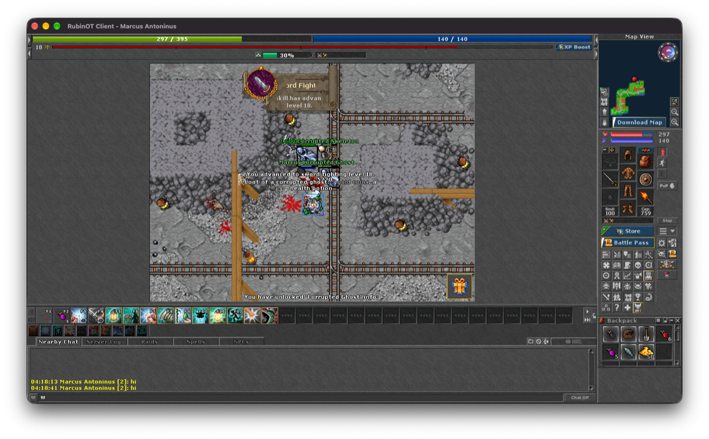
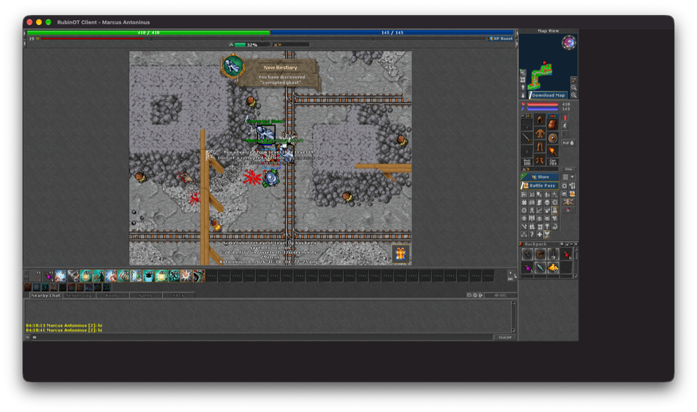
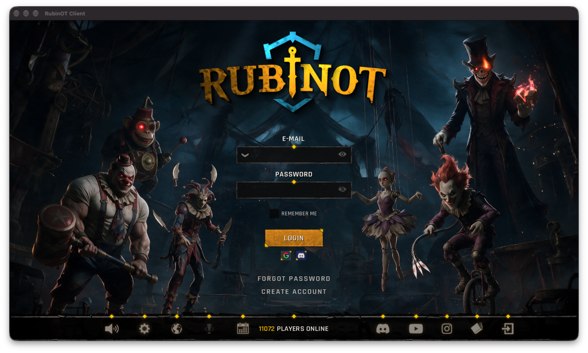
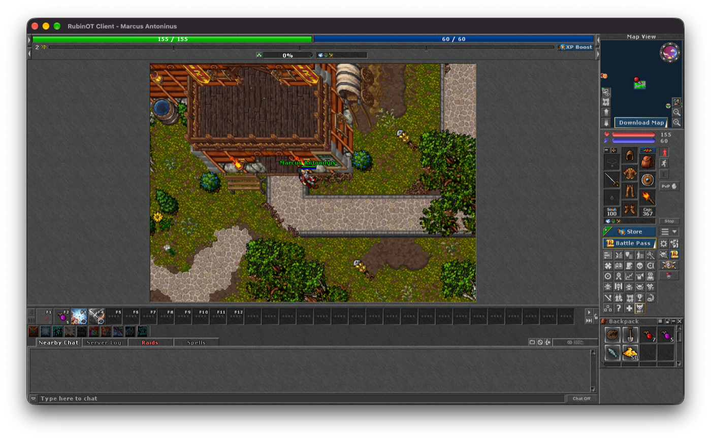

# RubinOT no macOS (WinApps)

**Situação: 🟡 Parcial** (08/11/2026) — o cliente 4.068 roda **in-game** no motor do
WinApps (login, mapa, chat, inventário, loja, Battle Pass; janela com escala; X fecha;
minimizar sem perder a imagem), **mas a sessão ainda cai de vez em quando** (ver
[Queda da sessão](#queda-da-sessão-7-min-depois-do-login)). O vigia (`watchdog.sh`)
reabre o cliente sozinho.

## Receita

Pré-requisitos: motor do WinApps com os patches (`winapps setup`), WebView2 no ambiente
(`winapps components webview2`) e `brew install innoextract mingw-w64`.

```bash
# 1) app do jogo (o instalador Inno quebra no Wine; extrair sem rodar)
P="$HOME/Library/Application Support/WinApps/prefixes/default"
innoextract -e -d /tmp/rubinot ~/Downloads/Setup-RubinOT-*.exe
mkdir -p "$P/drive_c/RubinOT" && cp -R /tmp/rubinot/app/* "$P/drive_c/RubinOT/"

# 2) sincronizar pelo manifesto, instalar as bibliotecas do cliente, vigia e atalho
bash programas/rubinot/install.sh          # RUBINOT_PREFIX=<ambiente> para outro

# (só se mexer no código do cliente) recompilar as DLLs de cliente/
bash programas/rubinot/build.sh
```

O `install.sh` baixa os arquivos que faltam do manifesto
(`https://updater.emac.ac/updater/@rubinot/v2`), confere `size`/`sha256`, guarda o
`emac-client64.dll` real como `.real`, instala a biblioteca de compatibilidade e cria
`~/Applications/RubinOT.app` apontando para `bin/x64/rubinot_dx.exe`.

## Por que o launcher não é usado

O `RubinOT.exe` (launcher Tauri) funciona no Wine — renderiza, atualiza e mostra JOGAR —
mas ao jogar ele instala/sobe o **serviço do driver** do EMAC:

```
EMACServiceInstaller.exe /install EMACDRVGLTB /product TB /path EMAC-Driver-GL-TB-x64.sys
```

O serviço é um driver de kernel (`Type=2`, grupo FSFilter). No Wine:
`Failed to start service, error code: 1114`; trocando por um serviço user-mode falso ele
avança e para em `Failed to initialize driver controller, error code: 6`.

O cliente `bin/x64/rubinot_dx.exe` **não precisa do launcher**: sobe sozinho e chega ao
login. O ajuste é a biblioteca `emac-client64` do cliente.

## Bibliotecas de compatibilidade do cliente

`rubinot_dx.exe` é empacotado (VMProtect) e resolve o `emac-client64.dll` em runtime. A
biblioteca de compatibilidade (`cliente/emac-client64-stub.c` + `.def`) exporta os 10
símbolos que o cliente espera:

```
CLHB CLVER PF SLG SWND USR USR2 USR3 USR4 USRLGT
```

responde sucesso e registra as chamadas em `bin/x64/emac-stub-calls.log`.

```bash
bash programas/rubinot/build.sh    # gera cliente/emac-client64-stub.dll e cliente/avrt.dll
```

Com ela o cliente abre o login, autentica e entra no jogo.

## Correções no motor (necessárias no caminho)

| Patch | O que resolve |
|---|---|
| `0002` ole32 | `RevokeDragDrop` em janela de outro processo (launcher morria com page fault em `0x7B572BD3`; agora compilado também em 32-bit) |
| `0006` win32u/winemac | janelas-filhas de outro processo (WebView2 do launcher) |
| `0007` dcomp + `dxmt/0002-0003` | composição do Chromium → Metal |
| `0010`–`0013` winemac | filhas remotas (o launcher mostra a UI) |

O motor agora é compilado com `--enable-archs=i386,x86_64` (`PE32_MODULES="ole32"`), e o
`vendor.sh`/`install_engine_patches` instalam `i386-windows/`.


## Tamanho do render / janela grande (corrigido — avrt.dll)

Sintoma: o cliente abre numa janela de 1360×768 e crescer a janela não adianta — o
jogo continua 1360×768 no canto e o resto fica com o fundo chapado. A janela também
não deixa encolher abaixo disso.

Causa (medida com um proxy injetado, ver abaixo): o cliente fixa o tamanho do render
no startup. Ele chama `AdjustWindowRectEx(1367×801)` para calcular a janela e usa
esse tamanho para o render e para a UI; depois nunca re-cria o buffer no `WM_SIZE`.

Correção (`cliente/win-size-hook.c`, instalado como `bin/x64/avrt.dll`):

- o cliente importa `avrt.dll` do Windows e o Wine procura primeiro no diretório do
  executável — então um `avrt.dll` ali roda código dentro do jogo, sem tocar no exe;
- o DLL patcheia a **IAT** do exe no `DllMain` (antes do packer resolver as APIs);
- intercepta `AdjustWindowRectEx`: nas primeiras chamadas grandes, troca o retângulo
  pelo tamanho desejado (`FORCED_W × FORCED_H`, hoje **2400×1300**). O cliente então
  cria/redimensiona a janela nesse tamanho e o render acompanha
  (`GetClientRect` devolve o tamanho real);
- exporta as 4 funções `avrt` que o cliente importa (sem isso ele não carrega).

Resultado medido: janela **2409×1335** (cliente 2401×1301) e conteúdo preenchendo
(0,6% de fundo chapado). Para outro tamanho, mude `FORCED_W/FORCED_H` e rode
`bash programas/rubinot/build.sh`.

## Redimensionar a janela (escala — avrt.dll + patch 0020)

A janela pode ser aumentada ou diminuída à vontade: o jogo inteiro (render e UI) é
escalado junto, mantendo a proporção.

- `avrt.dll`: o primeiro tamanho de área cliente que o jogo lê (2401×1301) vira o
  tamanho **virtual** fixo. Daí em diante `GetClientRect` (do jogo e do ANGLE, que é
  estático no exe) e `WM_SIZE` sempre devolvem esse tamanho, então o buffer não muda.
  O wndproc do jogo é envolvido: o mouse é convertido da janela real para o tamanho
  virtual, `WM_SIZING` mantém a proporção (o winemac sempre manda um canto; vale a
  dimensão que mais mudou) e `WM_GETMINMAXINFO` deixa encolher até 1/5. Pedidos de
  tamanho do próprio jogo (`SetWindowPos`/`MoveWindow`) são ignorados depois disso.
- Patch **0020** (winemac): a superfície criada para o DXMT não estava na lista do
  win32u e ficava no tamanho de criação (a janela só recortava — era o "jogo no canto").
  Agora `macdrv_WindowPosChanged` a atualiza, e a camada Metal estica o back buffer até
  a view (`kCAGravityResize`, como `DXGI_SCALING_STRETCH` no Windows).

 

Testado: 2401×1316 → 1200×665 (login inteiro, escalado), clique no "Remember me" na
posição escalada, arrastar o canto (proporção mantida).

## Fechar pelo X

O cliente ignora o pedido de fechar da janela (X / Cmd+Q não faziam nada). O
`avrt.dll` repassa o `WM_CLOSE`/`SC_CLOSE` ao jogo normalmente e, se ele não tiver
saído em 2 s, encerra o processo (`TerminateProcess`). Log: `fechar: …` em
`avrt-hook.log`. Testado: X fecha o jogo e o `crash_handler.exe` junto.


## Queda da sessão ~7 min depois do login

Medido três vezes: o cliente **fecha sozinho ~7m09s depois de entrar no mundo**
(16:06:14→16:13:23, 16:46:26→16:53:34, 16:56:24→17:03:34). Não é aleatório: é um
timer/expiração de sessão.

O canal do EMAC é fornecido pelo **launcher** (`RubinOT.exe`, Rust/Tauri): ele sobe um
servidor WebSocket (`127.0.0.1:34254`, mensagens JSON, `tokio-tungstenite`) e carrega o
`emac-client64`. No Wine ele **se relança elevado** (`--elevated`) para falar com o
driver de kernel (`EMACDRVGLTB`); a instância elevada trava sem janela e sem socket,
então o canal nunca existe. Sem o launcher, o cliente perde o EMAC na primeira
renovação (~7 min) e fecha.

Biblioteca de compatibilidade (`cliente/emac-client64-stub.c`, instrumentada) registra
as chamadas com hora e argumentos — padrão observado:

```
PF(84f9d0, 141894380, 11, 30) -> 0      heartbeat
USR3(1447fd4f0, 1447fd4a8, 30, 30) -> 0 no login
USR4(1447fd4d0, 1447fd4a8, 1, 4) -> 0   no login
```

**Enquanto isso — vigia** (`watchdog.sh`, iniciado pelo `install.sh`): se o cliente sair
sozinho, reabre o `RubinOT.app` (confere a cada 8 s; desiste após 3 reaberturas que não
duram 60 s). Desligar: `touch "<ambiente>/.rubinot-sem-vigia"`. Log: `/tmp/rubinot-vigia.log`.

Caminho para não cair mais: fazer o launcher rodar sem elevação/driver (patch no binário
Rust, sem símbolos) **ou** emular o canal EMAC que ele serve.

## Minimizar quebrava o jogo (corrigido — patch 0019)

Sintoma: minimizar (botão amarelo/Cmd+M) e voltar deixava o cliente **em branco para
sempre** (medido: 93% de fundo chapado + bloco branco 256×128; resize, hide/show e
re-minimizar não recuperavam — só reiniciar).

Diagnóstico: o motor aguenta o ciclo — apps de teste D3D11 e ANGLE (mesmas libs do
cliente) passam por minimizar/restaurar com `Present` S_OK e `eglGetError` SUCCESS.
O cliente é que não recria o estado gráfico ao voltar. Esconder o app (Cmd+H) é
seguro: o cliente continua rodando e a imagem volta intacta (medido: 0,6% de fundo
chapado antes e depois).

Correção (`patches/0019-winemac-rubinot-minimize-hides-app.patch`, nesta pasta): em
`-[WineWindow miniaturize:]`, se o título começa com `RubinOT`, chama
`[NSApp hide:nil]` em vez de miniaturizar. O botão amarelo passa a esconder o app
(como Cmd+H) e o clique no ícone do Dock traz a janela de volta **sem quebrar**.


## Qualidade de jogabilidade

- Renderer: ANGLE **OpenGL ES 3.0** (o cliente escolhe sozinho: D3D11 > OpenGL > D3D9);
  para tentar Metal (DXMT) há a opção de engine gráfico nas configurações do cliente.
- Custo medido: ~1,3 núcleo com o jogo aberto (Rosetta + ANGLE/GL).
- O que já foi visto funcionando: login, personagem no mapa, chat, inventário, map view,
  painel de batalha, loja e Battle Pass.





## Arquivos

| Caminho | O quê |
|---|---|
| `install.sh` | sincroniza pelo manifesto, instala as bibliotecas do cliente, registra o WebView2, liga o vigia e cria o atalho |
| `build.sh` | recompila `cliente/*.dll` (mingw) |
| `cliente/emac-client64-stub.c` `.def` | biblioteca de compatibilidade `emac-client64` |
| `cliente/win-size-hook.c` `.def` | `avrt.dll`: tamanho/escala da janela e X fecha |
| `watchdog.sh` | vigia: reabre o cliente quando a sessão cai |
| `set-window.py` | ajusta o `config.otml` (tamanho inicial; desliga o log de debug do ExitLag, que chegou a 21 GB) |
| `patches/0002` | ole32: `RevokeDragDrop` em janela de outro processo (launcher; compilado 32 e 64-bit) |
| `patches/0019` | winemac: minimizar o RubinOT esconde o app |
| `imagens/` | capturas |

Os patches daqui são aplicados pelo `engine/build-engine.sh` junto com os gerais
(`patches/` na raiz), na ordem do número. Patches gerais que o jogo também usa:
`0005`/`0020` (DXMT, render e escala), `0006`/`0007`/`0010`–`0013` + `dxmt/0002`–`0003` (WebView2 do launcher).
